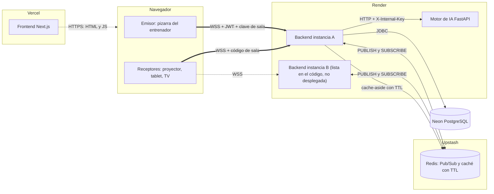
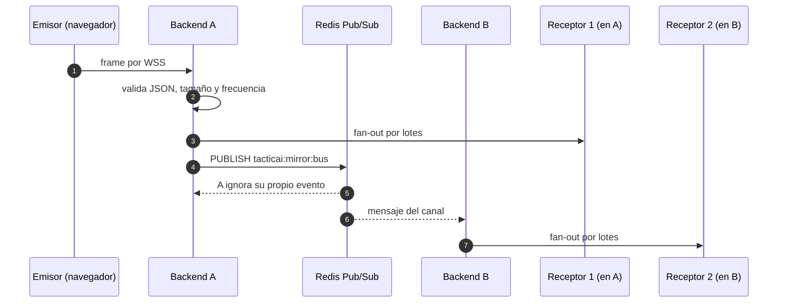

# 🏀🎾 TacticAI — Simulador Táctico (Frontend)

> **Simulador táctico de baloncesto y tenis con IA, web workers, PWA y renderizado híbrido.**
> Caso de Estudio 2 · Programación Orientada a la Web


---

## 👨‍🎓 Autoría

| | |
|---|---|
| **Desarrollado por** | David Fernando Ramírez de la Parra |
| **Profesor** | Jhonatan Andrés Mideros Narváez |
| **Asignatura** | Programación Orientada a la Web |
| **Institución** | Universidad Cooperativa de Colombia |

---

## 🌐 Aplicación en vivo

| Servicio | URL |
|---|---|
| 🖥️ **Frontend (Vercel)** | https://tactical-sim-frontend.vercel.app |
| ⚙️ Backend (Render) | https://tactical-sim-backend.onrender.com |
| 🧠 Motor de IA (Render) | https://tactical-sim-ai-engine.onrender.com |

> ⏳ **Nota:** el backend y la IA están en el plan gratuito de Render y se duermen por inactividad. La primera petición puede tardar ~50 s (arranque en frío). Es una limitación del plan, no un error.

---

## 📚 El caso de estudio

**TacticAI** es un simulador táctico de baloncesto y tenis. El entrenador dibuja jugadas sobre una cancha, y el sistema calcula la probabilidad de éxito de cada acción (tiro, pase, penetración, saque) y simula la respuesta defensiva del rival.

El caso de estudio exige una aplicación web moderna que:

1. 🧠 Ejecute **cálculos de IA pesados sin bloquear la interfaz** (trabajo fuera del hilo principal).
2. ⚡ Mantenga una **interacción fluida** (INP bajo, buen manejo del Event Loop).
3. 📴 Funcione **sin conexión** (PWA, Service Worker, almacenamiento local).
4. 🔀 Use **distintas estrategias de renderizado** (CSR, SSG, ISR, SSR, Streaming SSR) con criterio.
5. 🔎 Aplique **SEO técnico**.
6. 🏗️ Tenga una **arquitectura por capas** con backend, motor de IA y base de datos separados.
7. 🔐 Sea **seguro** y esté **probado y desplegado** con CI.

---

## ✅ ¿Cuánto cumple el proyecto?

| Requisito | Evidencia en el proyecto | Cómo verificarlo |
|---|---|---|
| IA fuera del hilo principal | Pool de **Web Workers** (`SpaceEngine`) + IA en servicio FastAPI separado | Ruta `/`, panel del laboratorio local |
| Memoria compartida | **SharedArrayBuffer + Atomics** (modos `shared` / `copy` / `main`) | Panel de rendimiento, indicador de modo |
| `crossOriginIsolated` | Cabeceras **COOP `same-origin` + COEP `require-corp`** en `next.config.mjs`; fuentes autoalojadas | Consola: `crossOriginIsolated` → `true` |
| PWA / offline | `manifest`, iconos, `public/sw.js` (v3), `offline.html` | DevTools → Application → "Offline" |
| Almacenamiento local | **IndexedDB** para pizarras ("Modo Campo") | Guardar una pizarra sin conexión |
| Tiempo real | **WebSocket (WSS)** espejo de pantalla con JWT, **Redis Pub/Sub** como backplane, caché cache-aside, receptores por instancia | Proyectar y abrir `/?viewer=CODIGO`; página `/estado` |
| Renderizado híbrido | CSR + SSG + ISR + SSR + Streaming SSR | Página `/renderizado` |
| SEO técnico | metadata, canonical, Open Graph, JSON-LD, `sitemap.xml`, `robots.txt`, HTML semántico | Ver código fuente / `/sitemap.xml` |
| Seguridad | JWT + 2FA, CORS, clave interna entre servicios | Ver README del backend |
| Pruebas y CI | **56 pruebas** (vitest) + GitHub Actions (Node 20/22) | Pestaña *Actions* |
| Despliegue | Vercel + Render + Neon | URLs de arriba |

### ⚠️ Límites (dicho con honestidad)

- 🧪 La IA se entrenó con **datos sintéticos** (generados por reglas, semilla 42), no con partidos reales.
- 🛡️ La respuesta defensiva ("Cuerpo Técnico Rival") está **basada en reglas**, no aprendida.
- 📐 El laboratorio local es una **estimación geométrica**, no el modelo del servidor.
- 🧵 La ganancia de los workers depende de los núcleos de la máquina (en un entorno de 2 núcleos medí ×0.85; mejora con más núcleos).
- 🧠 Las salas del espejo se guardan en **Redis** (sobreviven a un reinicio del backend). Si Redis no está configurado o se cae, el backend vuelve a memoria local. En producción hay **una sola instancia**; el uso con varias está probado con pruebas automáticas del backend.
- 📨 **No hay broker de mensajes con colas** (RabbitMQ/Kafka); lo asíncrono se resuelve con Workers, hilo secundario en la IA, WebSocket y **Redis Pub/Sub** (*at-most-once*).
- 🚪 Hay un único módulo `gateway` dentro del backend, no un API Gateway regional dedicado.
- 🌐 La verificación automatizada se hizo en **Chromium**. En Firefox/Safari, si `SharedArrayBuffer` no está disponible, el motor cae a los modos `copy`/`main`.
- 🔍 La ruta `/` es CSR, por eso no es indexable (las páginas públicas sí lo son).

---

## 🏗️ Arquitectura

El proyecto se compone de **3 repositorios**:

```
┌──────────────────────────┐      ┌──────────────────────────┐      ┌──────────────────────────┐
│  tactical-sim-frontend   │ ───▶ │   tactical-sim-backend   │ ───▶ │  tactical-sim-ai-engine  │
│  Next.js · Vercel        │ REST │  Spring Boot · Render    │ HTTP │  FastAPI · Render        │
│  Workers · PWA · SW      │  WS  │  JWT+2FA · Neon Postgres │ +key │  Modelos + Monte Carlo   │
└──────────────────────────┘      └──────────────────────────┘      └──────────────────────────┘
```

### Mapa por capas

| Capa | Dónde vive | Qué hace |
|---|---|---|
| 🖥️ Cliente | Este repo | UI, Workers, PWA, IndexedDB, espejo |
| 🚪 Edge / Gateway | Módulo `gateway` del backend | JWT + 2FA, CORS, rutas públicas, oculta la URL de la IA |
| ⚙️ Aplicación | Backend | API REST `/api/v1`, reglas de negocio |
| 🔄 Asíncrona | Workers, hilo secundario de la IA, WebSocket + Redis Pub/Sub | Trabajo fuera del hilo principal y reparto entre instancias |
| ⚡ Caché / tiempo real | Redis (Upstash), solo el backend accede | Backplane Pub/Sub del WebSocket y caché con TTL |
| 🧠 IA | Servicio FastAPI | Modelos entrenados + Monte Carlo, protegido con clave interna |
| 🗄️ Datos | Neon Postgres | Solo el backend accede |
| 🚀 DevOps | GitHub Actions, Dockerfile, Vercel, Render | CI y despliegue |

> 📄 Detalle completo en [`docs/ARQUITECTURA.md`](docs/ARQUITECTURA.md) y [`docs/CUMPLIMIENTO.md`](docs/CUMPLIMIENTO.md).

---

## 🔀 Patrones de renderizado

| Ruta | Estrategia | ¿Por qué? |
|---|---|---|
| `/` | **CSR** (`dynamic`, `ssr:false`) | Es una herramienta interactiva con canvas, Workers e IndexedDB; no necesita SEO |
| `/metodologia` | **SSG** | Contenido estático, máxima velocidad y SEO |
| `/jugadas`, `/jugadas/[id]` | **SSG** (`generateStaticParams`, `dynamicParams=false`) | Catálogo conocido de antemano |
| `/renderizado` | **SSG** | Página explicativa |
| `/modelo` | **ISR** (`revalidate = 300`) | Datos del modelo cambian poco; los sirve la **caché de Redis** del backend, con *snapshot* de respaldo |
| `/estado` | **SSR** (`force-dynamic`) | Estado en vivo de backend, IA, **Redis** y **WebSocket** (por instancia) |
| `/plataforma` | **Streaming SSR** (`Suspense`) | La parte lenta no bloquea el resto |
| `/sitemap.xml`, `/robots.txt` | Generadas | SEO técnico |

**Trade-offs:** CSR = interactividad rica pero peor SEO · SSG = rápido y barato pero estático · ISR = equilibrio con datos semi-frescos · SSR = datos siempre frescos, mayor coste por petición · Streaming = mejor percepción de carga.

---

## 🧵 Workers, SharedArrayBuffer y `crossOriginIsolated`

El cálculo del **mapa de calor** (cuadrícula 100×94) y la simulación **Monte Carlo** (σ = 2.5) corren en un **pool de Web Workers** (`max(2, min(4, núcleos-1, 6))` hilos).

| Modo | Cómo comunica | Cuándo se usa |
|---|---|---|
| `shared` | `SharedArrayBuffer` + `Atomics` (sin copiar) | Si `crossOriginIsolated === true` |
| `copy` | `postMessage` con copia de datos | Si no hay SAB pero sí Workers |
| `main` | Hilo principal | Último recurso (nunca rompe la app) |

- Para habilitar `SharedArrayBuffer` el navegador exige **aislamiento de origen**: `Cross-Origin-Opener-Policy: same-origin` + `Cross-Origin-Embedder-Policy: require-corp`. Por eso las fuentes se **autoalojan** (`@fontsource`).
- `SpaceEngine.run()` conserva solo la **última petición pendiente**, evitando acumular trabajo obsoleto.
- Las matemáticas puras están en `spaceMath.js` y son **deterministas** (probado: paridad entre modos).

---

## ⚡ Conceptos de clase aplicados

- 🔁 **Event Loop:** Call Stack, Task Queue y Microtask Queue (las microtareas tienen prioridad). Si el hilo principal se bloquea, la UI no responde → por eso la IA va en Workers.
- 🖼️ **Ciclo del frame:** Main Thread (JS, estilos, layout), Compositor Thread y Raster/GPU. Mantener libre el Main Thread permite llegar a 60 fps.
- 🧱 **Pipeline de render:** DOM → CSSOM → Render Tree → Layout → Paint → Composite.
- 📏 **INP** = retraso de entrada + duración del procesamiento + retraso de presentación.
  Umbrales: ✅ Bueno < 200 ms · ⚠️ Mejorable 200–500 ms · ❌ Malo > 500 ms. Reemplaza a FID. Objetivo del proyecto: ~100–150 ms.
- 👷 **Web Worker vs Shared Worker vs Service Worker:** el proyecto usa *Web Workers* (cómputo) y *Service Worker* (caché/offline).
- 📬 **`postMessage` vs `SharedArrayBuffer`:** copiar datos vs compartir memoria.

---

## 📴 PWA y Modo Campo

- 📲 Instalable (`manifest`, iconos).
- 🛠️ `public/sw.js` (**VERSION v3**) aprende los recursos mediante el mensaje `CACHE_URLS` y sirve `offline.html` si no hay red.
- 💾 **IndexedDB**: pizarras guardadas localmente ("Modo Campo"). Probado con `fake-indexeddb`.
- 🪞 **Espejo de pantalla** por WebSocket: un entrenador transmite y otros ven en `/?viewer=CODIGO` (ver [📡 Tiempo real](#-tiempo-real-websockets--redis)).

---

## 📡 Tiempo real: WebSockets + Redis

> Tema de clase: **"Tiempo real en la Web: WebSockets y Redis"**. Aquí está el **lado cliente** y la visión de conjunto; el **lado servidor** (backplane Pub/Sub, caché cache-aside, claves de Redis, pruebas con varias instancias) está explicado a fondo en el [README del backend](https://github.com/TU-USUARIO/tactical-sim-backend#-tiempo-real-websockets--redis).

### 🔌 WebSocket en una frase

Una conexión que **empieza como HTTP** (`Upgrade: websocket`, el *handshake*) y luego queda como un **canal TCP persistente, bidireccional y full-duplex**: el servidor puede **empujar** datos sin que el navegador pregunte (*polling*). Sirve para eventos en tiempo real: marcadores en vivo, chats, *streaming*, pizarras compartidas. **WSS** = WebSocket sobre TLS: en producción Render sirve HTTPS, así que el espejo de TacticAI viaja **cifrado**.

> 🧠 **Cambio de paradigma:** HTTP es *stateless* (petición → respuesta → se libera la memoria). Un WebSocket **mantiene estado por conexión** (un objeto en RAM y un descriptor de archivo en el servidor mientras dure). Por eso importa el **problema C10K**, el **patrón *fan-out*** (un mensaje → muchos receptores, que no debe recorrerse en un solo hilo) y el **reto distribuido** (con dos servidores el mensaje se pierde sin un **backplane Pub/Sub**, y las *sticky sessions* se evitan). El backend lo resuelve con **Redis**.

### 🏗️ Arquitectura



> ℹ️ En producción corre **una sola instancia** del backend (plan gratuito de Render); el código y las pruebas automáticas cubren varias. La instancia B del diagrama es la que se activaría al escalar.

### 🔄 Recorrido de un frame



### 🖥️ Qué hace el frontend

| Pieza | Archivo | Responsabilidad |
|---|---|---|
| **Emisor** | `useMirrorEmitter.js` | Crea la sala (`POST /api/v1/mirror/rooms`, con JWT), abre el WebSocket, envía **frames** (máx. ~30 por segundo: si llegan más seguidos, solo sale el último) y se **reconecta solo** con espera creciente (1, 2, 4, 8 s…; hasta 12 intentos ≈ 80 s, lo que tarda Render en reiniciar) |
| **Visor / proyector** | `useMirrorViewer.js`, `MirrorViewer.jsx` | Se conecta solo con el **código de sala** (sin login, solo lectura), muestra el último frame y descarta los más viejos para no "retroceder" |
| **Protocolo** | `mirrorProtocol.js` | Funciones **puras y probadas**: URL WSS, subprotocolos con el JWT, lectura de los mensajes `hello` y `viewers` |
| **Panel** | `ui/MirrorPanel.jsx` | Muestra el código, el enlace del proyector y **cuántos receptores hay conectados y por qué instancia del backend** |
| **Atajo local** | `BroadcastChannel` | Si el proyector es otra pestaña del **mismo navegador**, la imagen llega al instante sin pasar por internet |

**Mensajes del servidor que entiende el cliente:** `hello` (rol, receptores, instancia), `viewers` (total y desglose por instancia), `emitter` (emisor en línea o no), `frame`, `ping` (se responde `pong`) y `closed`.

### 👥 Receptores por instancia (demostración del backplane)

Al proyectar, el panel muestra, por ejemplo:

```
3 receptores conectados
  srv-1a2-4f9   2 receptores · instancia a la que estás conectado
  srv-9f0-c31   1 receptor
```

El nombre es el de la instancia del backend que atiende a cada grupo de receptores (`INSTANCE_ID` o `RENDER_INSTANCE_ID` + sufijo aleatorio). El proyector también lo muestra en su barra superior. Con **una** instancia (producción) verás una sola fila; con varias, un grupo por instancia: es la evidencia visible de que el mensaje cruza instancias vía Redis.

### 🔐 Seguridad del canal (visión del cliente)

- **WSS**: `https://…` → `wss://…` (derivado de `NEXT_PUBLIC_API_URL`).
- **JWT fuera de la URL**: el navegador no permite cabeceras `Authorization` en un WebSocket, así que el emisor lo manda en el **subprotocolo** (`new WebSocket(url, ["tacticai.mirror", "jwt.<token>"])`). Va en una cabecera del handshake y **no queda en la URL ni en los logs de un proxy**. Verificado en Chromium real.
- El **origen** lo valida el servidor contra `CORS_ALLOWED_ORIGINS`.
- El visor **solo lee**: no envía nada salvo `pong`.
- El frontend **nunca** conoce `REDIS_URL`: Redis lo usa solo el backend.

### ⚡ Caché con Redis (lo que se ve en el frontend)

- **`/modelo` (ISR, 5 min)** pide las métricas al backend (`/api/v1/meta/model`), que responde desde **Redis** (*cache-aside*, TTL 5 min) y solo pregunta a la IA si hace falta. La página dice de dónde salieron los datos (caché de Redis, origen, copia obsoleta…). Si el backend no responde, usa el flujo anterior (IA directa) y, como último recurso, la instantánea de la compilación.
- **`/estado` (SSR)** muestra además el estado de **Redis** (¿responde? ¿modo Redis o memoria?, aciertos y fallos de caché) y del **WebSocket** (instancia, salas, receptores, lotes del último reparto, ¿hay otras instancias?, eventos publicados y recibidos).

### 🧪 Pruebas del tema (21 nuevas)

| Archivo | Qué comprueba |
|---|---|
| `tests/mirrorProtocol.test.js` | `https`→`wss` / `http`→`ws`; el JWT **nunca** va en la URL; subprotocolos válidos; sin token no se abre el canal del emisor; lectura de `hello`/`viewers` con el desglose por instancia (la propia primero); textos de la interfaz |
| `tests/metaStatus.test.js` | Frases de `/modelo` según el origen del dato (Redis, memoria, obsoleto, origen); lectura de la respuesta del backend; resumen de `/estado` (Redis sano, caído o sin configurar) |

Además se comprobó **a mano en Chromium** que el handshake con subprotocolo funciona de verdad y que la URL no contiene el token.

### ⚠️ Límites (dicho con honestidad)

- 🔢 Con **una instancia** en producción, la interfaz muestra un solo grupo de receptores; el cruce entre instancias está **probado en el backend con pruebas automáticas**, no desplegado.
- 📮 El Pub/Sub de Redis no guarda mensajes (*at-most-once*): un frame perdido lo corrige el siguiente.
- 🔓 El proyector entra solo con el **código de sala** (no tiene login): quien conozca el código puede **mirar** (no emitir).
- 🧪 Solo se verificó el handshake en Chromium; Firefox y Safari usan la misma API estándar pero no se probaron.

---

## 🔎 SEO técnico

`metadata` por página · URL **canonical** · **Open Graph** · **JSON-LD** (`WebApplication`) · `sitemap.xml` · `robots.txt` · HTML **semántico**. La URL base sale de `NEXT_PUBLIC_SITE_URL` → `VERCEL_PROJECT_PRODUCTION_URL` → valor por defecto.

---

## 🎨 Modo claro / oscuro

Modo **claro por defecto**, con alternador a oscuro (`ThemeToggle`, `theme.css`, guardado en `localStorage` como `ta-theme`). Botón **Arquitectura** en la barra superior y enlace en el login.

---

## 🔐 Seguridad (visión del frontend)

- El frontend **nunca** conoce la clave interna, `REDIS_URL` ni los secretos del backend/IA.
- Las llamadas de servidor (`/estado`, `/modelo`) usan `timedFetch` (timeout de 4 s, nunca lanza excepciones).
- `npm audit --audit-level=high` corre en CI → **0 vulnerabilidades**.

---

## 🛠️ Requisitos

- Node.js **≥ 20.9**
- npm

## 🚀 Uso local

```powershell
git clone https://github.com/TU-USUARIO/tactical-sim-frontend.git
cd tactical-sim-frontend
npm install
npm run dev
```

Abre http://localhost:3000

```powershell
npm test          # 56 pruebas (vitest)
npm run build     # compilación de producción
npm start         # servir el build
```

## 🔧 Variables de entorno

| Variable | Obligatoria | Descripción |
|---|---|---|
| `NEXT_PUBLIC_API_URL` | ✅ | URL del **backend** (también de ahí sale la URL **WSS** del espejo). ⚠️ Se incrusta en **tiempo de build**: si la cambias, vuelve a desplegar |
| `BACKEND_URL` | ✅ | URL del backend para peticiones de servidor |
| `AI_ENGINE_URL` | ✅ | URL del **motor de IA** (no la del backend) |
| `NEXT_PUBLIC_SITE_URL` | ➖ | URL pública del sitio (SEO). Si falta, usa la de Vercel |

Ejemplo local (`.env.local`):

```env
NEXT_PUBLIC_API_URL=http://localhost:9096
BACKEND_URL=http://localhost:9096
AI_ENGINE_URL=http://localhost:8000
```

## ☁️ Despliegue (Vercel)

Next.js necesita un host Node/SSR (no sirve un sitio estático).

1. Importa el repo en **Vercel**.
2. Configura las variables de entorno de la tabla.
3. Despliega. Cada `push` a `main` redespliega.
4. En el backend, añade el dominio de Vercel a `CORS_ALLOWED_ORIGINS` **sin espacios** tras la coma.

## 🧪 Pruebas y CI

**56 pruebas** con vitest: determinismo y paridad de `spaceMath`, *fallback* de `SpaceEngine`, pizarras offline (`fake-indexeddb`), jugadas predefinidas, formato, `serverFetch`, `seo` y, del tema de tiempo real, el **protocolo del espejo** (WSS, JWT por subprotocolo, receptores por instancia) y el **estado de Redis/caché**.
GitHub Actions: Node **20 y 22** → `npm test` · `npm run build` · `npm audit --audit-level=high`.

## 📂 Documentación

- 🏛️ [`docs/ARQUITECTURA.md`](docs/ARQUITECTURA.md)
- ✅ [`docs/CUMPLIMIENTO.md`](docs/CUMPLIMIENTO.md)

## 🗺️ Próximos pasos

- Probar manualmente en Firefox y Safari.
- Entrenar la IA con datos reales.
- Escalar el backend a varias instancias en Render y medir el reparto real (hoy probado con pruebas automáticas).
- Cola de mensajes con persistencia (Redis Streams) si se necesitara entrega garantizada.
- Medir INP real en producción (RUM).

---

<p align="center">
Hecho con ☕ y mucho código por <b>David Fernando Ramírez de la Parra</b><br>
Profesor: Jhonatan Andrés Mideros Narváez · Programación Orientada a la Web · Universidad Cooperativa de Colombia
</p>
